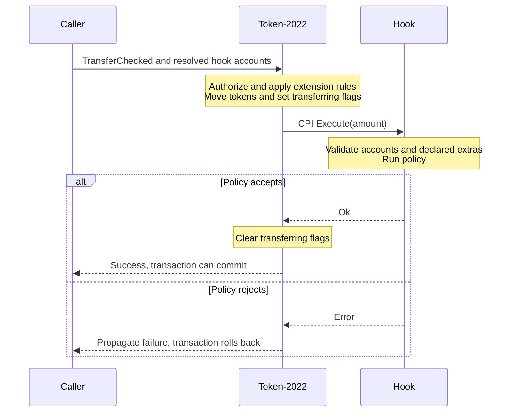

<Info>
  A transfer hook is a program that a Token-2022 mint points at. Token-2022 calls it on every checked transfer, and an error from the hook cancels the whole transfer. A hook sees accounts and amounts, not people, and a mint with a hook is not automatically usable on Raydium.
</Info>

<Note>
  The examples use the community `raydium-transfer-hook` kit. The kit is unaudited and private. The excerpts on this page are enough to follow it, and only [Test it](#test-it) needs repository access. Hook behavior depends on the deployed program, the cluster and the caller. Recheck each Raydium operation when any of them changes.
</Note>

## What a hook can and cannot do

A hook is a rule that runs inside a transfer. Use one for limits, pauses, eligibility or vesting that the token must enforce even when it trades in a pool.

| A hook can | A hook cannot |
|---|---|
| Reject the transfer, which rolls back the whole transaction. | Change the transfer. Token-2022 has already moved the tokens. |
| Read the accounts, the amount and the post-transfer balances. | See who is really acting or why. It sees addresses, not people. |
| Update its own policy state through declared writable accounts. | Run on mint, burn or authority-change instructions. |

Send hooked tokens with `TransferChecked`. Token-2022 needs the mint to find the hook. A self-transfer can return without invoking the hook, so a successful self-transfer does not show that your policy ran.

A hook cannot read amounts on a confidential-transfer mint, because those balances are hidden. The kit's templates refuse such mints at setup. Mint, burn and authority changes skip the hook, so a rule that depends on supply also depends on who can still mint.

## How a transfer reaches the hook

The [Transfer Hook interface](https://www.solana-program.com/docs/transfer-hook-interface) defines `Execute(amount)`. Token-2022 calls it with a cross-program invocation (CPI): one program calling another inside the same transaction. The callee is the hook program selected by the mint's TransferHook extension.



Token-2022 authorizes the transfer and moves the tokens first. It then sets a `transferring` flag on both token accounts and calls the hook. The hook sees post-transfer balances.

A hook error rolls back the transaction, including earlier successful instructions in it. Transaction fees still apply.

The hook's fixed accounts are read-only and unsigned. Token-2022 checks the owner or delegate before it calls the hook. That signer privilege does not carry into `Execute`. The authority can differ from the source account's owner, and neither address identifies a person.

## Accounts and the metadata list

`Execute` receives four transfer accounts, then the metadata list, then any declared extras:

| Position | Account | Purpose |
|---|---|---|
| 0 | Source token account | Holds the balance after the debit. |
| 1 | Mint | Identifies the token and selected hook. |
| 2 | Destination token account | Holds the balance after the credit. |
| 3 | Owner or delegate | Authority already checked by Token-2022; unsigned here. |
| 4 | Extra-account metadata-list PDA | Describes the hook's additional accounts. |
| 5+ | Declared extra accounts | Policy configuration, credentials or other dependencies. |

The list lives at a program-derived address (PDA): an address with no private key that only its owning program can sign for. See [PDAs and CPIs](/docs/en/solana-fundamentals/pdas-and-cpis). Its seeds are `["extra-account-metas", mint]` under the hook program.

The list stores each extra account in type-length-value (TLV) form. An entry can be a fixed key, a key derived from instruction data, or a key and data taken from an earlier account. See the interface's [extra-account configuration](https://www.solana-program.com/docs/transfer-hook-interface/configuring-extra-accounts).

The Starter declares one extra: a read-only configuration PDA at position 5, derived from `["hook-config", mint]`. It stores the limit used below.

Your client resolves these accounts, because Token-2022 cannot look them up over RPC. The `@solana/spl-token` helper reads the mint, finds the hook, reads the list and appends the extras:

```ts
import {
  createTransferCheckedWithTransferHookInstruction,
  TOKEN_2022_PROGRAM_ID,
} from "@solana/spl-token";

const instruction = await createTransferCheckedWithTransferHookInstruction(
  connection,
  sourceTokenAccount,
  mint,
  destinationTokenAccount,
  owner.publicKey,
  500n,            // raw units
  decimals,
  [],              // multisig signers
  "confirmed",
  TOKEN_2022_PROGRAM_ID,
);
```

An on-chain caller must forward the same accounts into its own CPI. See [Hook tokens on Raydium](#hook-tokens-on-raydium).

## A complete rule: the transfer limit

The Starter's whole policy is one comparison. Its `RuleParams` holds a single `limit`, and setup rejects a zero limit:

```rust rule.rs
pub fn enforce_transfer_limit(
    rule_params: &RuleParams,
    transfer_context: &TransferContext,
) -> Result<(), TransferHookStarterError> {
    if transfer_context.amount > rule_params.limit {
        return Err(TransferHookStarterError::TransferExceedsLimit);
    }
    Ok(())
}
```

With a limit of 500, the rule gives these outcomes:

| Raw amount | Outcome |
|---|---|
| 499 | Allowed. |
| 500 | Allowed: the boundary is inclusive. |
| 501 | Rejected with `TransferExceedsLimit`. |

The rule compares validated values. It does not parse accounts, resolve metadata or record anything.

On a mint with six decimals, 500 raw units are 0.0005 tokens. A per-transfer cap does not stop someone from splitting a large transfer into small ones or using several wallets.

## What the shared validation protects

Your rule never parses accounts. `hook-kit` is a Rust library compiled into your hook program. It validates the `Execute` accounts first, then hands the rule a `TransferContext`: the amount, the account addresses, the post-transfer balances and any Token-2022 transfer fee. The amount is the amount before the fee, and the destination receives the amount minus the fee. A `TransferContext` is a Rust value for one invocation, not an on-chain account.

The validation checks that:

- The mint selects this hook program.
- Both token accounts belong to the mint, and both `transferring` flags are set. A direct call to `Execute` therefore fails.
- The account count is exact, and no unexpected remaining accounts are present.
- The fixed accounts are read-only and unsigned, and the extras match their declared privileges.
- The metadata PDA has the right address, owner and exact canonical bytes.

The Starter's `execute.rs` calls the validation, then the rule. This excerpt needs that file's imports and Anchor account constraints:

```rust execute.rs
let transfer_hook_config = accounts.transfer_hook_config.to_account_info();
let transfer_context = accounts
    .execute_account_infos(accounts.transfer_hook_config.extra_account_meta_list_bump)
    .validate(
        ctx.program_id,
        amount,
        &[&transfer_hook_config],
        ctx.remaining_accounts,
        &EXTRA_ACCOUNT_META_LIST,
    )?;
```

After a configuration-version check, the handler applies the rule:

```rust execute.rs
rule::enforce_transfer_limit(
    &accounts.transfer_hook_config.rule_params,
    &transfer_context,
)?;
```

Each template still owns its setup authority, state writes and error behavior. Keep its Anchor account constraints. The shared validation does not replace them.

## Test it

The Starter ships with native tests, a JSON scenario and a one-command runner. These commands need access to the private kit repository and the build tools in its contributing guide. LiteSVM runs the compiled program inside your test, so it needs no wallet, SOL or validator.

```bash
git clone https://github.com/trilltino/raydium-transfer-hook.git
cd raydium-transfer-hook
cargo test --locked -p transfer-hook-starter --lib
cargo install --path hook-host --features cluster --bin test-scenario --locked
test-scenario check --program-dir templates/simple/transfer-hook-starter \
  --scenario hook-host/examples/starter.json
```

The native tests check the rule's boundaries. `check` builds a private copy of the Starter with its own program ID, then runs the JSON scenario through Token-2022 under LiteSVM. These steps are an excerpt of the scenario:

```json starter.json
    {
      "name": "500 is accepted",
      "transfer": {
        "from": "a",
        "to": "b",
        "amount": "500"
      },
      "expect": "success"
    },
    {
      "name": "501 is refused",
      "transfer": {
        "from": "a",
        "to": "b",
        "amount": "501"
      },
      "expect": {
        "error": "TransferExceedsLimit"
      }
    },
    {
      "name": "bob holds 500",
      "assert": {
        "balance": {
          "account": "b",
          "equals": "500"
        }
      }
    }
```

Add `--report <file>` to save the result, or `--url devnet` to deploy the copy and repeat the cases on Devnet.

Rollback matters as much as the rejection. The kit's typed example checks that a rejected 501 leaves both balances unchanged, and that an accepted first instruction rolls back with a rejected second one.

The kit's [host guide](https://github.com/trilltino/raydium-transfer-hook/blob/main/hook-host/GUIDE.md) covers the next steps: [testing your own program](https://github.com/trilltino/raydium-transfer-hook/blob/main/hook-host/GUIDE.md#test-your-own-hook-from-a-json-scenario) from a generated scenario, [dry-running a transfer](https://github.com/trilltino/raydium-transfer-hook/blob/main/hook-host/GUIDE.md#create-a-hooked-mint-and-dry-run-a-transfer) on an existing mint, Devnet runs and pool tests.

## Who can change the rule

Before you trade or provide liquidity for a hooked token, find out who can change its behavior after you deposit. Four parties can:

| Party | Can change | How to check |
|---|---|---|
| Mint's transfer-hook authority | Which program the mint calls, through the `Update` instruction of the TransferHook extension. | `getTransferHook`, or `test-scenario inspect` |
| Hook program's upgrade authority | The hook's code. | `solana program show <HOOK_PROGRAM_ID>` |
| Mint authority | The supply, by minting. Hooks do not run on mint, so a rule that depends on supply is weak while this authority exists. | Read the mint's authority field |
| The hook's own configuration authority | The hook's parameters, if it has any. | The template's setup and update instructions |

The extra-account list is not a fifth party. In the kit, every template implements the standard `UpdateExtraAccountMetaList` instruction without an authority check, and it accepts only the canonical list the program computes for the mint. Anyone can repair a stale list. Nobody can use it to change what the hook accepts. A hook outside the kit can gate that instruction differently, so check it.

Read the first one from a client:

```ts
import { getMint, getTransferHook, TOKEN_2022_PROGRAM_ID } from "@solana/spl-token";

const mintInfo = await getMint(connection, mint, "confirmed", TOKEN_2022_PROGRAM_ID);
const hook = getTransferHook(mintInfo);

console.log("hook program:", hook?.programId.toBase58());
console.log("can repoint it:", hook?.authority.toBase58());
```

An authority of `11111111111111111111111111111111` means none: it is revoked. The rule is fixed only when every party above is revoked or is someone you trust.

Read the hook program from the mint on every send. Never cache it, because the authority can repoint it between two transfers.

The kit's `initialize` needs the Transfer Hook authority to sign, so revoke that authority after setup, not before. The authority can also remove the hook with `SetAuthority` on the hook program ID. Neither change makes a transfer fail, so senders and custodians should watch the mints they hold for them.

## Hook tokens on Raydium

### Admission

A hook belongs to a mint, and Raydium admits mints separately. CPMM and CLMM accept five Token-2022 extensions, and TransferHook is not one of them. Pool creation for a hook mint reverts with `NotSupportMint` unless an admin has registered the mint. See the [extension allow-list](/docs/en/reference/token-2022-support#cpmm-and-clmm-extension-allow-list) and the [per-mint registry](/docs/en/reference/token-2022-support#the-one-bypass-the-per-mint-registry).

Registering a mint does not vet its hook. The hook runs on every transfer and can make swaps fail. The kit's pool tests run against community integration forks, which are separate from official Raydium deployments.

### Forwarding extras

Admission is not enough. Every transfer leg needs the hook's extras: swaps, liquidity deposits and withdrawals, and fee and reward transfers. Resolve them with each leg's actual mint, authority and amount.

A program that moves hooked tokens by CPI must forward the extras itself. This excerpt of the kit's `cpi.rs` shows the pattern with the public `spl-transfer-hook-interface` helper:

```rust cpi.rs
    let hook_program_id = {
        let mint_data = mint.try_borrow_data()?;

        transfer_hook::get_program_id(&StateWithExtensions::<Mint>::unpack(&mint_data)?)
    };

    if let Some(hook_program_id) = hook_program_id {
        add_extra_accounts_for_execute_cpi(
            &mut instruction,
            &mut account_infos,
            &hook_program_id,
            source_token_account.clone(),
            mint.clone(),
            destination_token_account.clone(),
            authority.clone(),
            amount,
            additional_accounts,
        )?;
    }

    invoke_signed(&instruction, &account_infos, signer_seeds)?;
```

Test LaunchLab setup and graduation separately. A passing direct transfer does not establish any pool path.

### Rules around pool vaults

In a swap, one side of each hooked transfer is a pool vault. The vault's owner is the pool program, not the trader, so the hook sees the vault and not the person trading. A rule that treats buys and sells differently has to identify venues by registered vault addresses.

- Decide how exits are treated. Pausing transfers blocks exits as well as buys.
- Owner-keyed rules need `ImmutableOwner` on the destination. Without it, `SetAuthority` can move the account to an unchecked wallet without a transfer.
- A counter over vault outflows counts the transfers the hook saw. It does not count trades, transactions or bundles.

### Sending a hooked token

Simulate the transfer before you sign it. `test-scenario simulate` resolves the hook's extras from the mint's list and dry-runs the transfer with no signature and no SOL. It names the error if the transfer would fail, and it prints a suggested compute limit.

Use the helper for your client library. Legacy web3.js uses `createTransferCheckedWithTransferHookInstruction` from `@solana/spl-token`, shown above. Kit and web3.js v3 use `getTransferCheckedWithTransferHookInstructionAsync` from `@solana-program/token-2022`.

On a mint with a transfer fee, send a plain `TransferChecked`. Token-2022 withholds the fee itself, and the hook sees the amount before the fee.

### Cost

A hook adds accounts to the transaction, compute to the instruction and one CPI level. Check the account and size limits in [Transactions and fees](/docs/en/solana-fundamentals/transactions-and-fees). Measure the compute against a plain transfer.

Token-2022 calls the hook by CPI, so a Raydium swap reaches the hook two levels below Raydium: Raydium, then Token-2022, then the hook. Using the counting in [PDAs and CPIs](/docs/en/solana-fundamentals/pdas-and-cpis#cpi-depth-limit), that leaves Raydium at most two levels below the top-level instruction. Every router or aggregator above Raydium uses part of that budget.

### When a transfer fails

| Symptom | Likely cause | Fix |
|---|---|---|
| A policy error such as `TransferExceedsLimit` | The rule refused the transfer. | Read the hook's error. The transaction rolled back, including earlier instructions in it. |
| An account-count or account-validation error on a send | The client left out the hook program, the list or an extra. | Resolve the extras from the list. A client that omits them cannot send the token. |
| A transfer that used to work now fails with an account-validation error | The hook program or its extras changed. | Re-read the mint, re-resolve the extras and rebuild the transaction. Do not resubmit the old one. |
| `TransferNotInProgress` on a direct call to `Execute` | Only Token-2022 sets the `transferring` flags. | Expected. Test through a real transfer. |
| A swap works for plain tokens but fails for the hooked token | The integrating program did not forward the extras on every leg. | Forward them for each leg, with that leg's amount and authority. |
| `NotSupportMint` when creating a pool | The mint's TransferHook extension is not admitted. | See [Admission](#admission). |

`TransferExceedsLimit` comes from the Starter, and each template defines its own policy errors. Account and setup errors come from the shared kit and start at code `0x8001`. They include `TransferNotInProgress`, `InvalidExecuteAccountCount`, `IncorrectHookProgram` and `InvalidExtraAccountMetaList`.

## Before you ship

- Name the controller, the issuer and the upgrade authority. Decide which to revoke, and revoke the Transfer Hook authority only after setup. See [Who can change the rule](#who-can-change-the-rule).
- Verify hook selection, Token-2022 ownership, mint bindings and both `transferring` flags. See [What the shared validation protects](#what-the-shared-validation-protects).
- Keep the canonical metadata, the account order and count, and the signer and writable privileges. Forward the extras on every CPI transfer leg.
- Separate the transfer authority from the token-account owner. Use `ImmutableOwner` where the policy depends on the owner. Consider mint, burn and authority changes separately.
- Test zero, limits, arithmetic extremes, self-transfer, entry, exit and the extension combinations you support. Check exact errors and rollback.
- Report native, LiteSVM, cluster and pool results separately. Assert every state change you promise.

## Pointers

- [`solana-fundamentals/pdas-and-cpis`](/docs/en/solana-fundamentals/pdas-and-cpis): PDAs, CPIs and the depth limit.
- [`solana-fundamentals/transactions-and-fees`](/docs/en/solana-fundamentals/transactions-and-fees): transaction size, accounts and compute.
- [`solana-fundamentals/spl-token-and-token-2022`](/docs/en/solana-fundamentals/spl-token-and-token-2022): the other Token-2022 extensions.
- [`reference/token-2022-support`](/docs/en/reference/token-2022-support): which mints CPMM and CLMM admit.

Sources:

- [Token-2022 overview](https://www.solana-program.com/docs/token-2022).
- [Transfer Hook interface](https://www.solana-program.com/docs/transfer-hook-interface).
- [Solana transfer hook guide](https://solana.com/docs/tokens/extensions/transfer-hook) and [integration guide](https://solana.com/docs/tokens/extensions/transfer-hook-integration).
- [`raydium-transfer-hook`](https://github.com/trilltino/raydium-transfer-hook) kit and its [README](https://github.com/trilltino/raydium-transfer-hook/blob/main/README.md). Both require repository access.
