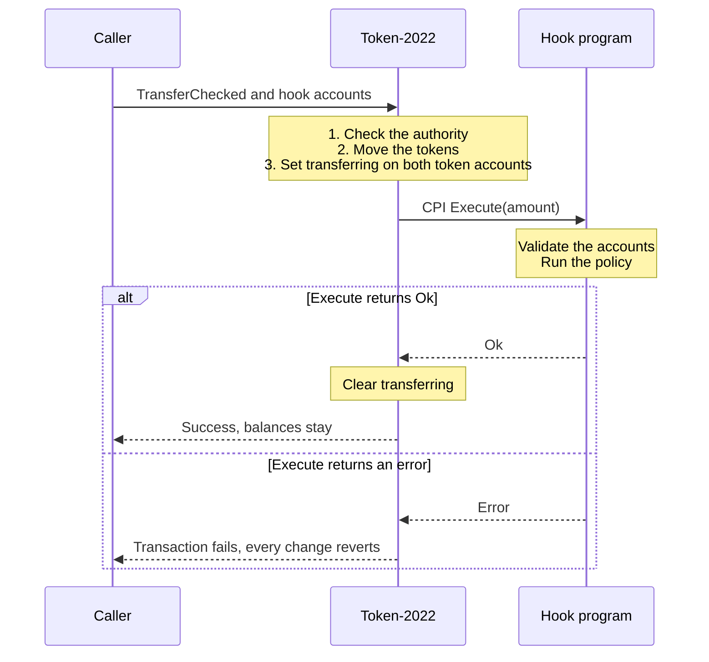
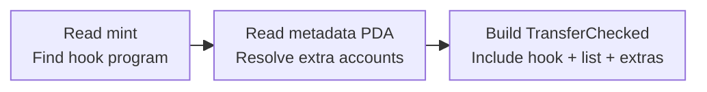
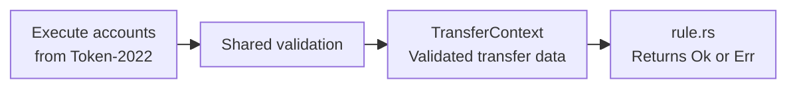

## Transfer hooks in Solana

SPL Token provides standard minting and transfer operations. Token-2022 adds optional extensions, including transfer hooks, so you can add custom behavior without maintaining a separate token program. A hook lets Token-2022 call your on-chain program during a transfer. The [Token-2022 overview](https://www.solana-program.com/docs/token-2022) explains this design.

A mint identifies a token and stores its configuration. Its TransferHook extension selects the hook program. In the [Solana guide's](https://solana.com/docs/tokens/extensions/transfer-hook) mint-creation transaction, this instruction selects `program.programId`; `wallet.publicKey` is the authority allowed to change that selection. The surrounding transaction allocates the mint account and initializes it.

```ts transfer-hook.test.ts
const selectHook = createInitializeTransferHookInstruction(
  mint.publicKey,
  wallet.publicKey,
  program.programId,
  TOKEN_2022_PROGRAM_ID,
);
```

Your hook can check recipient eligibility, enforce an amount limit, or record activity in its own state. Anchor is optional; the guide uses it for this example, which rejects transfers above 50 raw token units. This excerpt omits the guide's logging. Its accounts, error definition and instruction dispatch are in the full example; the [Starter implementation below](#from-transfer-accounts-to-policy-checks) includes transfer validation.

```rust lib.rs
pub fn transfer_hook(_ctx: Context<TransferHook>, amount: u64) -> Result<()> {
    if amount > 50 {
        return err!(MyError::AmountTooBig);
    }
    Ok(())
}
```

Deploy and configure the hook before transferring tokens. Token-2022 updates balances, then calls the hook within the same transaction. A propagated error reverts the transaction's state changes. Minting, burning and authority changes do not invoke it. Raydium swaps and liquidity operations involve wallet-to-vault transfers, so a compatible integration must admit the mint and forward the hook's required accounts. Check the [support matrix](/docs/en/reference/token-2022-support); Token-2022 support alone does not establish hook support.

## Why transfer hooks exist

Token authorization decides whether an owner or delegate may move tokens. A transfer hook adds rules about the movement itself. You can change those rules in your hook while reusing Token-2022 for balances and transfer authorization.

## Raydium integration context

A hook belongs to a token mint. It does not attach to a Raydium pool or automatically understand a swap, launch or liquidity position. The product operation determines which token transfers reach it. These are useful policy applications when the integration supports the required hook execution:

| Product | Possible token behavior | Integration requirements |
|---|---|---|
| **LaunchLab** | Recipient eligibility or purchase limits during a launch window. | Standard LaunchLab base-mint setup does not attach a TransferHook extension. A custom launch integration must implement the transfer path and test buying, selling, fee claims and graduation separately. Admitting a quote mint does not establish that support. |
| **CPMM** | Transfer limits or eligibility for tokens entering and leaving a constant-product pool. | The pool must admit the mint and forward hook accounts for swaps, deposits and withdrawals. A rule that accepts a buy may still reject a withdrawal. |
| **CLMM** | Eligibility or balance policies for assets traded through concentrated liquidity. | Check swaps, position funding, liquidity removal and applicable fee or reward transfers. CLMM position NFTs are separate from the pool's underlying tokens. |

Mint admission and account forwarding are separate requirements. The public [CPMM](https://github.com/raydium-io/raydium-cp-swap/blob/master/programs/cp-swap/src/utils/token.rs) and [CLMM](https://github.com/raydium-io/raydium-clmm/blob/master/programs/amm/src/util/token.rs) transfer helpers do not forward hook extras. An admin-managed mint registry can bypass the extension admission check, but it does not add that forwarding. The community kit's [CPMM/CLMM integration forks](https://github.com/trilltino/raydium-transfer-hook/blob/main/hook-host/GUIDE.md#test-with-cpmm-and-clmm) provide a development and testing path.

Decide what happens on exits as well as entry. A paused policy or revoked credential can block withdrawals if the rule treats every vault transfer alike. A hook sees transfer accounts and an amount; an outgoing vault transfer may use a pool PDA as authority. That authority is not a reliable identifier for the trader, and transfer direction alone does not prove which product operation happened.

If you're new to hooks, follow the transfer below and then [run the Starter](#build-test-and-adapt-the-starter). If you already know the interface, jump to the [implementation](#from-transfer-accounts-to-policy-checks) or [advanced workflows](#advanced-workflows).

## How a transfer reaches the hook

The [SPL Transfer Hook interface](https://www.solana-program.com/docs/transfer-hook-interface) defines `Execute`, the instruction your hook implements. Token-2022 calls it through a cross-program invocation, or CPI. Anchor can dispatch that instruction to a Rust handler, but the interface also supports native Rust programs.

| Participant | Responsibility |
|---|---|
| Caller or client | Builds `TransferChecked` for Token-2022 and supplies the hook accounts. |
| Token-2022 | Authorizes the movement, updates balances, applies extensions such as transfer fees, and invokes the hook. |
| Hook program | Validates the call and accounts, evaluates its policy, and optionally updates its own state or calls another program. |



<div style={{ fontSize: "0.82em", opacity: 0.7, marginTop: "0.75rem" }}>

*Figure 1.* Token-2022 moves the balances before calling the hook. A propagated hook error fails the transaction and reverts its state changes.

</div>

Token-2022 sets `transferring` flags on the source and destination accounts around the hook call. Check both flags, the token-program ownership and the mint bindings before trusting the inputs. The fixed transfer accounts reach the hook read-only and unsigned; the transfer authority's signature does not carry into the hook.

Use `TransferChecked`, which includes the mint needed to find the hook. Hooks do not run on mint, burn or `SetAuthority` instructions. Token-2022 also short-circuits transfers from an account to itself, so a successful self-transfer is not evidence that your hook ran.

## Accounts and the metadata list

The interface supplies four transfer accounts. The templates here also require an extra-account metadata list, followed by the accounts declared in that list:

| Position | Account | Purpose |
|---|---|---|
| 0 | Source token account | The account being debited. |
| 1 | Mint | Identifies the token and selected hook. |
| 2 | Destination token account | The account being credited. |
| 3 | Owner or delegate | The transfer authority, which does not sign for the hook. |
| 4 | Extra account metadata list | A PDA owned by the hook program. |
| 5 onward | Extra accounts | Policy state, credentials or other declared dependencies. |

The `ExtraAccountMetaList` PDA uses the seeds `["extra-account-metas", mint]` under the hook program. Each entry specifies an account address or a rule for deriving it, plus its privileges. A rule can reference a fixed key, instruction data, or keys and data from other accounts. The client resolves these entries before submitting the transfer.



<div style={{ fontSize: "0.82em", opacity: 0.7, marginTop: "0.75rem" }}>

*Figure 2.* A client or CPI helper reads the mint and metadata list, resolves the extra accounts, and includes them in the transfer instruction.

</div>

Token-2022 does not fetch missing accounts. A client can use `createTransferCheckedWithTransferHookInstruction` from `@solana/spl-token`, or Rust's `add_extra_account_metas_for_execute`. A program making the transfer must forward the resolved accounts into its CPI, for example with `add_extra_accounts_for_execute_cpi`. See [PDAs and CPIs](/docs/en/solana-fundamentals/pdas-and-cpis) for account forwarding.

## From transfer accounts to policy checks

The community [`raydium-transfer-hook` kit](https://github.com/trilltino/raydium-transfer-hook/tree/main) separates custom behavior from Token-2022 plumbing. [`hook-kit`](https://github.com/trilltino/raydium-transfer-hook/tree/main/hook-kit) is an on-chain Rust library compiled into your hook program. It validates the Token-2022 call and builds the `TransferContext` that your policy receives. Each template owns its policy in `rule.rs`.

[`hook-host`](https://github.com/trilltino/raydium-transfer-hook/tree/main/hook-host) runs on your development machine, not on-chain. It is the kit's test harness and CLI: it builds hook artifacts, resolves test accounts, runs transfers in LiteSVM or on Devnet, and checks the resulting logs and state. Your production client or CPI still has to resolve and forward the hook accounts for every real transfer.



<div style={{ fontSize: "0.82em", opacity: 0.7, marginTop: "0.75rem" }}>

*Figure 3.* The hook validates Token-2022's accounts, builds a `TransferContext`, and passes it to `rule.rs`. The rule accepts the transfer or returns an error.

</div>

1. Token-2022 calls `Execute` on the deployed hook. The Starter's [`lib.rs`](https://github.com/trilltino/raydium-transfer-hook/blob/main/templates/simple/transfer-hook-starter/src/lib.rs) uses the SPL instruction identifier to route the call to its handler.
2. Anchor creates `Context<Execute>`. Here, `Execute` names the template's accounts struct. Its constraints bind the configuration to this mint; the handler also checks token-program ownership.
3. Shared validation checks the selected hook, mint bindings, transferring flags, metadata PDA and bytes, account count and privileges. It returns a temporary `TransferContext` containing the amount, account addresses and balances after the transfer.
4. The handler passes the stored rule parameters and validated context to the policy. Each `?` returns immediately on failure; `Ok(())` returns control to Token-2022.

`TransferContext` is a Rust value for this invocation, not a new on-chain account. The configuration is stored on-chain and survives between calls. Both `hook-kit` and `rule.rs` compile into the hook program; calling their Rust functions does not require a separate transaction or CPI.

The following excerpt includes the Starter's full handler and its ownership helper. The imports and Anchor accounts struct are in the linked [`execute.rs`](https://github.com/trilltino/raydium-transfer-hook/blob/main/templates/simple/transfer-hook-starter/src/instructions/execute.rs). Keep those account constraints when adapting the template.

```rust execute.rs
pub fn execute(ctx: Context<Execute>, amount: u64) -> Result<()> {
    let accounts = &ctx.accounts;
    validate_token_interface_owner(&accounts.source_token_account)?;
    validate_token_interface_owner(&accounts.mint)?;
    validate_token_interface_owner(&accounts.destination_token_account)?;

    let transfer_hook_config = accounts.transfer_hook_config.to_account_info();
    let transfer_context = accounts
        .execute_account_infos(accounts.transfer_hook_config.extra_account_meta_list_bump)
        .validate(
            ctx.program_id,
            amount,
            &[&transfer_hook_config],
            ctx.remaining_accounts,
            &EXTRA_ACCOUNT_META_LIST,
        )?;
    require_eq!(
        accounts.transfer_hook_config.version,
        TRANSFER_HOOK_CONFIG_VERSION,
        TransferHookStarterError::UnsupportedVersion
    );

    rule::enforce_transfer_limit(
        &accounts.transfer_hook_config.rule_params,
        &transfer_context,
    )?;
    Ok(())
}

fn validate_token_interface_owner(account: &UncheckedAccount) -> Result<()> {
    require!(
        account.owner == &TOKEN_PROGRAM_ID || account.owner == &TOKEN_2022_PROGRAM_ID,
        ErrorCode::AccountOwnedByWrongProgram
    );
    Ok(())
}
```

### Worked example with a transfer limit

The Starter's [`rule.rs`](https://github.com/trilltino/raydium-transfer-hook/blob/main/templates/simple/transfer-hook-starter/src/rule.rs) defines `RuleParams` with a `u64` limit. Its setup validation rejects a zero limit. The policy below compares that limit with the validated transfer amount:

```rust rule.rs
pub fn enforce_transfer_limit(
    rule_params: &RuleParams,
    transfer_context: &TransferContext,
) -> Result<(), TransferHookStarterError> {
    if transfer_context.amount > rule_params.limit {
        return Err(TransferHookStarterError::TransferExceedsLimit);
    }
    Ok(())
}
```

| Amount with a limit of 500 | Result |
|---|---|
| 0 or 499 | Accepted. |
| 500 | Accepted, because the check uses `>` rather than `>=`. |
| 501 | Rejected with `TransferExceedsLimit`. |

Amounts use raw token units. For a mint with six decimals, a limit of 500 means 0.0005 tokens. Change the limit in configuration and the corresponding test expectations together. The Starter rejects confidential-transfer mint extensions during setup because its policy depends on a visible transfer amount.

## Build, test and adapt the Starter

Start with a passing transfer and a failing transfer, then change one rule at a time. The kit's [`CONTRIBUTING.md`](https://github.com/trilltino/raydium-transfer-hook/blob/main/CONTRIBUTING.md#tests) lists the required Rust and Solana build tools. Its [`AGENTS.md`](https://github.com/trilltino/raydium-transfer-hook/blob/main/AGENTS.md) maps policy, account, authority and testing responsibilities for experienced developers and AI-assisted builders.

Run these PowerShell commands from the directory where you want the checkout. After `cd`, all commands run from the kit's repository root. Install the documented toolchain first. Dependency installation and builds may download packages; local execution needs no wallet, SOL or validator.

```powershell
git clone --branch main https://github.com/trilltino/raydium-transfer-hook.git
cd raydium-transfer-hook
cargo test --locked -p transfer-hook-starter --lib
cargo install --path hook-host --features templates --bin test-templates --locked
test-templates build --template starter
test-templates local --template starter --report starter-local.json
```

`test-templates` is the `hook-host` CLI installed by the third command. The native tests check the rule and boundaries. Its `build` subcommand compiles the on-chain program into a `.so` artifact, and `local` uses LiteSVM to execute that artifact through actual Token-2022 transfers. Inspect the accepted and rejected cases and final balances in the report; a policy unit test alone cannot show that Token-2022 dispatched your hook correctly. Report files refuse overwrites, so choose a new filename when repeating the command.

The typed [`starter.rs` example](https://github.com/trilltino/raydium-transfer-hook/blob/main/hook-host/examples/starter.rs) uses the same policy with a source balance of 5,000, an empty destination and a limit of 500. After creating and initializing the fixture, its `CaseRunner` runs these cases:

```rust starter.rs
tests
    .transfer(
        &mut context,
        "500 accepted at maximum",
        (0, 1, 500),
        &[],
        ExpectedOutcome::Success,
    )
    .await?;
tests
    .transfer(
        &mut context,
        "zero accepted with hook invocation",
        (0, 1, 0),
        &[],
        ExpectedOutcome::Success,
    )
    .await?;
tests
    .transfer(
        &mut context,
        "501 rejected",
        (0, 1, 501),
        &[],
        custom(TransferHookStarterError::TransferExceedsLimit.code()),
    )
    .await?;
```

`CaseRunner::transfer` checks both balances and requires the hook's invocation in the logs. The accepted transfer leaves 4,500 at the source and 500 at the destination. The zero transfer succeeds without changing them; the rejected transfer must leave them unchanged. The full example also tests direct calls, invalid accounts, relay transfers and rollback of an earlier successful instruction.

### Make the policy your own

1. Describe one transfer that must pass and one that must fail. For a first experiment, edit the Starter in your checkout. Copy the nearest template when creating a separate program.
2. Change the pure policy in `src/rule.rs`. Pass time or slot values into a rule instead of reading the clock inside it, so native tests can supply boundary values.
3. Wire additional state reads, writes or CPIs into `instructions/execute.rs` after validation. Keep its setup instructions, account metadata, authority checks and client builders aligned.
4. Update native tests and runtime cases. If instructions or account layouts change, regenerate the IDL and rebuild the `.so` before testing.
5. Follow the [template registration checklist](https://github.com/trilltino/raydium-transfer-hook/blob/main/AGENTS.md#registering-a-new-program) when creating a new program. Use a program ID you control before deployment.

Keep client builders, the IDL and compiled artifacts from the same working copy. Policy functions should receive validated values; account parsing, authority checks and state writes belong in the handler. Successful cases need assertions for the promised state change, and rejected cases need assertions that state did not change.

## Advanced workflows

<AccordionGroup>

<Accordion title="Compose policies and recognize vault transfers">

A mint selects one hook program, but that program can evaluate several policies. Start with [Multi-Policy](https://github.com/trilltino/raydium-transfer-hook/tree/main/templates/intermediate/multi-policy) to combine local checks with an external recipient-allowlist CPI. Declare the CPI's accounts in the metadata list and bind the expected callee program.

For launch and trading rules, [Trader Eligibility](https://github.com/trilltino/raydium-transfer-hook/tree/main/templates/launch-and-trading/trader-eligibility) classifies source and destination token-account addresses against registered vaults. Its `required()` function chooses which owners need credentials:

```rust rule.rs
pub fn required(leg: Leg, sell_rule: SellRule) -> Checks {
    match (leg, sell_rule) {
        (Leg::Buy, _) => Checks {
            source: false,
            destination: true,
        },
        (Leg::Sell, SellRule::OpenExit) => Checks {
            source: false,
            destination: false,
        },
        (Leg::Sell, SellRule::RequireCredential) => Checks {
            source: true,
            destination: false,
        },
        (Leg::Transfer, _) => Checks {
            source: true,
            destination: true,
        },
    }
}
```

`Buy` means a registered vault sent tokens to a non-vault account; `Sell` means the reverse. These labels describe transfer direction, not proof of a Raydium swap. Liquidity withdrawal can also send tokens out of a vault. `OpenExit` skips sell-side credentials, while local amount limits still apply.

Other starting points include [Fair Launch](https://github.com/trilltino/raydium-transfer-hook/tree/main/templates/intermediate/fair-launch) for launch-window caps and [Fee Split Rewards](https://github.com/trilltino/raydium-transfer-hook/tree/main/templates/launch-and-trading/fee-split-rewards) for distributing supplied funding. Fee Split Rewards does not automatically collect Raydium fees, migrate LP positions or compound liquidity. Those operations belong in the integration. [Recipient Allowlist](https://github.com/trilltino/raydium-transfer-hook/tree/main/templates/intermediate/recipient-allowlist) is a policy provider called by hooks, not itself a mint hook.

</Accordion>

<Accordion title="Test a custom hook from JSON">

Use a JSON scenario when you want configurable setup, transfers and assertions without writing a Rust test. Build your hook and generate its IDL first. From your hook's project root, with `test-templates` installed:

```powershell
test-templates init-scenario --idl target/idl/my_hook.json --out tests/my-cases.json
# Edit setup arguments, unresolved accounts and expected outcomes before running.
test-templates local --scenario tests/my-cases.json `
  --program target/deploy/my_hook.so --report my-hook-local.json
```

The generator writes setup, an accepted transfer, a balance assertion and a draft rejected transfer. Neutral defaults do not know your policy: replace every unresolved account, configure valid setup arguments, and choose the exact rejection you expect. The committed [Starter scenario](https://github.com/trilltino/raydium-transfer-hook/blob/main/hook-host/scenarios/starter.json) shows a stored limit, a boundary transfer and a rejected transfer.

Paths inside JSON are relative to the scenario file; command-line paths are relative to your working directory. Write raw token amounts and 64-bit integers as decimal strings. Declare writable policy accounts explicitly in each transfer's `writable` field. The `hook-host` runner resolves accounts for its test transaction, but it does not grant authority or infer policy intent. Production callers must still resolve and forward those accounts themselves.

Use the [scenario examples](https://github.com/trilltino/raydium-transfer-hook/tree/main/hook-host/scenarios) for delegates, credentials, time advances, rewards and decoded-state assertions. A native Rust hook can use a hand-written minimal IDL. Use typed Rust cases for relay transfers and custom checks outside the JSON runner's supported vocabulary.

</Accordion>

<Accordion title="Write typed Rust runtime tests">

Use [the Rust host examples](https://github.com/trilltino/raydium-transfer-hook/blob/main/hook-host/GUIDE.md#test-in-rust) when a test needs typed setup, custom assertions or relay execution. The Starter example above uses a separate transfer-relay program, so build that artifact as described in [the test instructions](https://github.com/trilltino/raydium-transfer-hook/blob/main/CONTRIBUTING.md#tests), then run `cargo run --locked -p hook-host --features templates --example starter` from the kit root.

Add related policy accounts to `monitored_accounts`. The host checks rejected transactions against snapshots and matches the expected program error and instruction index. Test a rejected second instruction after an accepted first one to check transaction rollback. Require hook invocation so a short-circuited transfer cannot masquerade as an executed policy check.

The fixtures review extra-account privileges separately from resolving addresses. Approve required writable accounts explicitly, and check successful counters, rewards or policy state rather than relying only on a successful return value.

</Accordion>

<Accordion title="Run on Devnet or test an existing mint">

A cluster run checks deployment and transaction execution beyond LiteSVM. For built-in templates, use `test-templates private-copy --out ../my-hook` to create a sibling directory outside the source checkout, then build inside that copy. It replaces placeholder IDs with IDs whose keys you control. Run subsequent commands through `cargo run --locked -p hook-host --features templates --bin test-templates --` from the copy so the CLI uses its rewritten IDs.

For your own hook, align the IDL address, compiled program ID and program keypair. With the matching artifact and scenario, run from your project root:

```powershell
test-templates run --scenario tests/my-cases.json `
  --program target/deploy/my_hook.so `
  --program-keypair target/deploy/my_hook-keypair.json `
  --keypair <TEST_PAYER_PATH> --url https://api.devnet.solana.com `
  --report my-hook-devnet.json
```

This deploys the scenario's programs, runs the cases and closes the deployments afterward. Closing a program ID is permanent; use `--keep` to retain it for debugging. Rebuild with fresh IDs before deploying again after closure. Fees and test-state rent remain spent.

For an existing mint or deployment, use [`test-hook generate` and `test-hook run`](https://github.com/trilltino/raydium-transfer-hook/blob/main/hook-host/GUIDE.md#test-an-existing-mint-with-test-hook). They do not deploy your program. Review the generated transfer scenario and provide the actual owner or delegate with `--signer`; the payer's ability to pay fees does not authorize token movement.

The runners reject mainnet. Check confirmed status and balances or policy state, not just a simulation or local signature. Follow the [cluster guide](https://github.com/trilltino/raydium-transfer-hook/blob/main/hook-host/GUIDE.md#test-your-integration-against-a-cluster) for the full setup.

</Accordion>

<Accordion title="Test swaps and liquidity through CPMM/CLMM forks">

A direct transfer test does not prove a pool integration. `test-templates amm` delegates to `devnet-smoke` in the separate integration checkout. You need its deployment manifest, matching compiled pool artifacts and instruction builders. The payer must have the manifest's required authorities. Follow the [pool setup guide](https://github.com/trilltino/raydium-transfer-hook/blob/main/hook-host/GUIDE.md#test-with-cpmm-and-clmm), then run from a built private template copy:

```powershell
cargo run --locked -p hook-host --features templates --bin test-templates -- `
  amm --template starter --mode both --venue both `
  --keypair <AMM_AUTHORITY_KEYPAIR> --amm-manifest <AMM_DEPLOYMENT_JSON> `
  --amm-repo <INTEGRATION_REPO> --url https://api.devnet.solana.com `
  --report starter-pools.json
```

`smoke` covers accepted and rejected swaps; `lifecycle` exercises liquidity operations. Resolve extras for each transfer leg using its actual mint, authority and amount. Check vault balances, pool and position bookkeeping, policy state and rejection rollback. A rule that caps vault-to-holder transfers can reject a liquidity withdrawal even if its swap tests pass.

For a custom hook, add an `amm` block and `swap` or `liquidity` steps to a scenario, then use `amm --scenario` with the hook binary and program keypair. The [Starter pool scenario](https://github.com/trilltino/raydium-transfer-hook/blob/main/hook-host/scenarios/amm-starter.json) is a starting point. Pool scenarios need the integration tooling and cannot run through `local --scenario`.

Check skipped cases as well as failures: the runner's balance floor can leave templates untested. Pool and position rent remains spent. These tests exercise integration forks; they do not establish public-deployment support or LaunchLab graduation compatibility. Select the target programs from the deployment manifest and record their addresses and cluster with the result. See [program addresses](/docs/en/reference/program-addresses) for canonical Raydium programs.

</Accordion>

</AccordionGroup>

## Design and contribution checklist

- State the policy, its controller and one transfer that should pass or fail. Identify whether it applies to wallets, registered vaults or both.
- Preserve shared validation before policy execution or state writes. Validate extra-account addresses, ownership, privileges and bound fields.
- Check bypasses outside transfers. Owner-based policies may need `ImmutableOwner`; mint authority and account-authority changes need separate treatment. A per-wallet cap does not identify a person or stop multiple wallets.
- Specify exit behavior and who may update or upgrade the policy. Include zero amounts, limits, unsupported extension combinations and self-transfer behavior in your test design.
- Test native rules, compiled transfers and each intended product operation. Check account count, compute use, exact rejection and unchanged state after failure.

Share a new idea through [GitHub Issues](https://github.com/trilltino/raydium-transfer-hook/issues/new/choose). Include the intended behavior, a passing case, a failing case, authorities and limitations. A pull request adds the implementation and tests. Follow the kit's [contributing guide](https://github.com/trilltino/raydium-transfer-hook/blob/main/CONTRIBUTING.md).

## Scope and change disclaimer

These examples explain the interface and testing patterns; they do not constitute an audit or guarantee compatibility with every Raydium product. Behavior depends on the deployed hook, caller, mint extensions and cluster, and upgrades can change it without changing program addresses. Match clients, IDLs and artifacts, then test each affected operation on the intended deployment. See the upstream [deployment-scope disclaimer](https://github.com/trilltino/raydium-transfer-hook/blob/main/DISCLAIMER.md) for when to repeat those checks.

## Further reading

- [Transfer hook extension](https://solana.com/docs/tokens/extensions/transfer-hook)
- [Transfer hook integration guide](https://solana.com/docs/tokens/extensions/transfer-hook-integration)
- [SPL Transfer Hook interface](https://www.solana-program.com/docs/transfer-hook-interface)
- [SPL Token and Token-2022](/docs/en/solana-fundamentals/spl-token-and-token-2022)
- [Token-2022 support matrix](/docs/en/reference/token-2022-support)
- [Hook host guide](https://github.com/trilltino/raydium-transfer-hook/blob/main/hook-host/GUIDE.md)
