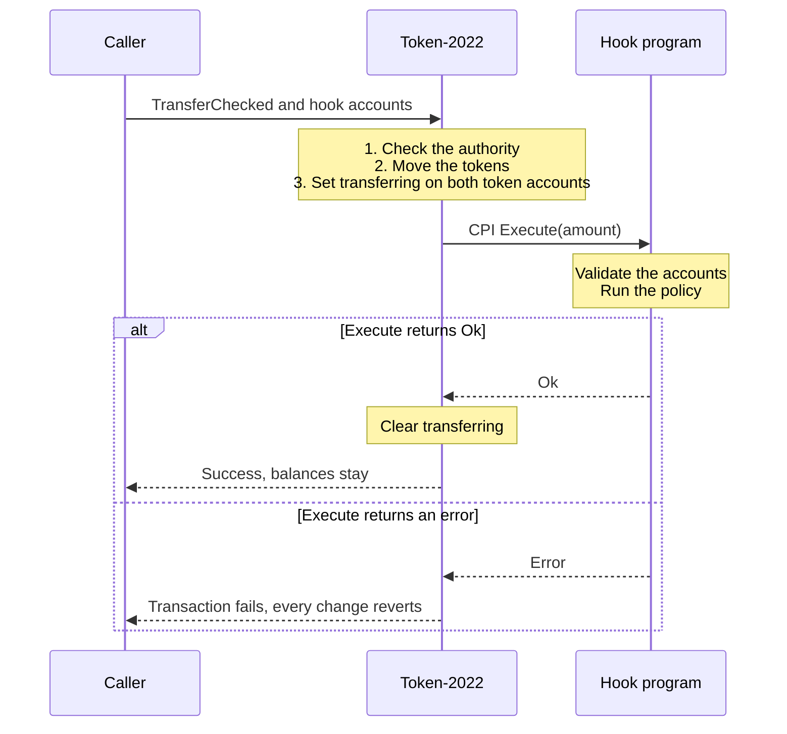

<Info>
  A mint can name a hook program. Token-2022 still authorizes and moves the tokens, and the hook adds one more check on every transfer. Any program or client that moves the mint has to supply the accounts the hook needs.
</Info>

The Token-2022 behavior on this page was last verified on 2026-10-28. The hook implementation and test commands were reviewed against `raydium-transfer-hook` commit `b7d598f287b62d0876e57d1c3947a79c6c20a3d9` (`main` on 2026-10-29). Rust excerpts are unchanged except for marked omissions. The commands below target LiteSVM or Devnet; they were reviewed against source, without rerunning the harness or sending cluster transactions for this documentation update. Program IDs are listed in [reference/program-addresses](/docs/en/reference/program-addresses).

## Scope and change disclaimer

This page is an informative guide to the Token-2022 Transfer Hook interface and to testing patterns. It is not an exhaustive compatibility matrix, an audit, or a guarantee that a particular hook will work with every Raydium product, deployment or transaction path.

The behavior you observe depends on the hook's actual implementation and on the program that calls it. A hook may add state, policy checks, CPIs, writable accounts, authority requirements, amount-dependent metadata or restrictions that this page does not describe. Raydium integrations may also change their account forwarding, Token-2022 extension admission, vault and position flows, fee or reward routing, errors, IDLs, SDKs or program IDs. A program upgrade can change those behaviors without changing its address. Cluster, deployment artifact, upgrade authority and runtime version also matter.

Treat the examples and test results here as starting points for a review. Before relying on a hook, inspect the exact deployed programs and mint extensions, align the client, IDL and compiled artifacts, resolve and approve every extra account, and run the affected operation on the target cluster. Recheck swaps, liquidity, LaunchLab, routing and other CPI paths separately. The upstream kit's [deployment-scope disclaimer](https://github.com/trilltino/raydium-transfer-hook/blob/b7d598f287b62d0876e57d1c3947a79c6c20a3d9/DISCLAIMER.md) records the review triggers and the evidence needed to call a result current.

## Why transfer hooks exist

Normal token authorization answers one question. May this owner or delegate move these tokens? A transfer hook lets the mint ask a second question about the transfer itself, such as whether the amount is within a limit or whether the receiver is eligible.

The hook is a program that the mint's creator chooses, and the mint's hook authority can change it later. Token-2022 calls it on every transfer of that mint, and an error from the hook fails the transfer. This reaches every program that moves the mint, including pools, so a developer who builds on Raydium needs to know how a hooked transfer is constructed.

## Mental model

| Who | Responsibility |
|---|---|
| Token-2022 | Authorizes the transfer, moves the balances, applies other extensions such as transfer fees, and calls the hook |
| Hook program | Checks that the call is a real transfer, applies its policy, and optionally reads or writes its own state |
| Caller or client | Builds a `TransferChecked` instruction and supplies the accounts the hook declares |

## How a transfer reaches the hook

Token-2022 calls the hook after it has moved the tokens. The accounts the hook reads show the state after the transfer. If the hook returns an error, the whole transaction fails and the balance changes revert.



<div style={{ fontSize: "0.82em", opacity: 0.7, marginTop: "0.75rem" }}>

*Figure 1.* The order of events in a hooked transfer. Each column is one participant, and time runs from top to bottom. Solid arrows are calls, dashed arrows are replies, and grey boxes are work a participant does on its own. The framed section at the bottom shows two possible outcomes, and only one of them happens. Token-2022 finishes moving the tokens before it calls the hook, so the hook sees the end state. If `Execute` returns `Ok`, Token-2022 clears the flag and the transfer succeeds. If it returns an error, the transaction fails and every change in it reverts.

</div>

- Token-2022 sets a `transferring` flag on the source and destination token accounts before it calls the hook, and clears it afterwards. Only Token-2022 writes that flag, so a hook that checks it can tell a real transfer from a direct call to `Execute`.
- The hook receives the amount but not the sender's signature. The five fixed accounts arrive read-only and unsigned.
- A plain `Transfer` instruction fails on an account with the hook extension, because Token-2022 needs the mint to find the hook. Callers use `TransferChecked`.
- Hooks run on transfers only. Minting and burning never call them.

## Accounts and the metadata list

`Execute` always receives five accounts, in this order. Any extra accounts follow.

| Position | Account | Notes |
|---|---|---|
| 0 | Source token account | Read-only |
| 1 | Mint | Read-only |
| 2 | Destination token account | Read-only |
| 3 | Owner or delegate | The authority that approved the transfer. It identifies a token-account owner, not a person, and it does not sign for the hook |
| 4 | Extra account metadata list | PDA of the hook program |
| 5 and later | Extra accounts | Defined by the list |

The hook declares its extra accounts in an `ExtraAccountMetaList`, a PDA of the hook program derived from `["extra-account-metas", mint]`. It works as a contract between the hook and its callers. Each entry describes one extra account as a fixed public key, or as a PDA of the hook program or of another program in the list. A PDA seed can be literal bytes, the key of an earlier account, or a byte range read from an earlier account's data. Each entry also says whether the account is writable.

```
 mint
   |  TransferHook extension names the hook program
   v
 hook program
   |  PDA ["extra-account-metas", mint]
   v
 ExtraAccountMetaList      declares the extra accounts and their privileges
   |  a client or CPI helper reads the list and resolves every entry
   v
 complete TransferChecked  carries the hook program, the list account
                           and every resolved extra account
```

<div style={{ fontSize: "0.82em", opacity: 0.7, marginTop: "0.75rem" }}>

*Figure 2.* How a client finds the extra accounts. The mint names the hook program, and the hook program owns the PDA that lists its extra accounts. A client or CPI helper reads that list, resolves each entry, and adds the results to the transfer instruction before it sends it.

</div>

Token-2022 does not look the extras up. A client reads the list and builds the instruction with a helper such as `createTransferCheckedWithTransferHookInstruction` in `@solana/spl-token` (0.4.15), or `add_extra_account_metas_for_execute` in the Rust `spl-transfer-hook-interface` crate. A program that moves a hook mint through a CPI forwards the same accounts itself, for example with `add_extra_accounts_for_execute_cpi`. If any account is missing, the transfer fails. See [PDAs and CPIs](/docs/en/solana-fundamentals/pdas-and-cpis) for how remaining accounts pass through a CPI.

## A safe implementation pattern

A hook program has four layers. Keeping them apart makes each one easy to review and test.

```
 Execute accounts from Token-2022
        |
        v
 shared validation        is this a real transfer of the right mint?
        |
        v
 TransferContext          validated amount, accounts and balances
        |
        v
 rule.rs                  pure policy function
        |
      Ok / Err
```

<div style={{ fontSize: "0.82em", opacity: 0.7, marginTop: "0.75rem" }}>

*Figure 3.* Where a developer's policy code sits in a hook. Shared validation runs first and produces a `TransferContext`. The rule only ever sees that validated context, so it can be a pure function that a unit test calls directly.

</div>

Shared validation does the work every hook needs, before any policy runs. It confirms that:

- the mint belongs to Token-2022 and points to this program;
- both token accounts belong to that mint and have the `transferring` flag set;
- the metadata list account is the canonical PDA and holds the expected bytes;
- the fixed accounts are read-only and unsigned, and each extra account has the privileges the list declares;
- no unexpected accounts follow the declared extras.

[`raydium-transfer-hook`](https://github.com/trilltino/raydium-transfer-hook/blob/b7d598f287b62d0876e57d1c3947a79c6c20a3d9/hook-kit/src/execute.rs) is a reference implementation of this split. Its `ExecuteAccountInfos::validate()` runs those checks and returns a `TransferContext`. The Starter hook then passes that context to its rule. This excerpt is from the Starter's [`execute.rs`](https://github.com/trilltino/raydium-transfer-hook/blob/b7d598f287b62d0876e57d1c3947a79c6c20a3d9/templates/simple/transfer-hook-starter/src/instructions/execute.rs).

```rust
// Source: raydium-transfer-hook@b7d598f287b62d0876e57d1c3947a79c6c20a3d9
// Runtime: LiteSVM; program IDs: reference/program-addresses
// Source-reviewed: 2026-10-29; no Raydium SDK dependency
pub fn execute(ctx: Context<Execute>, amount: u64) -> Result<()> {
    let accounts = &ctx.accounts;
    // token-program owner checks on source, mint and destination omitted

    let transfer_hook_config = accounts.transfer_hook_config.to_account_info();
    let transfer_context = accounts
        .execute_account_infos(accounts.transfer_hook_config.extra_account_meta_list_bump)
        .validate(
            ctx.program_id,
            amount,
            &[&transfer_hook_config],
            ctx.remaining_accounts,
            &EXTRA_ACCOUNT_META_LIST,
        )?;
    // config version check omitted

    rule::enforce_transfer_limit(
        &accounts.transfer_hook_config.rule_params,
        &transfer_context,
    )?;
    Ok(())
}
```

The policy code never parses a raw `AccountInfo`, the common transfer checks live in one place, and the rule is small enough for an ordinary unit test. Validation does not prove that a policy is safe. It only guarantees that the policy runs on a genuine transfer.

## Worked example with a transfer limit

The Starter rule rejects any transfer above a configured limit. It is the part of the hook that a developer writes. This is [`rule.rs`](https://github.com/trilltino/raydium-transfer-hook/blob/b7d598f287b62d0876e57d1c3947a79c6c20a3d9/templates/simple/transfer-hook-starter/src/rule.rs).

```rust
// Source: raydium-transfer-hook@b7d598f287b62d0876e57d1c3947a79c6c20a3d9
// Runtime: LiteSVM; program IDs: reference/program-addresses
// Source-reviewed: 2026-10-29; no Raydium SDK dependency
pub fn enforce_transfer_limit(
    rule_params: &RuleParams,
    transfer_context: &TransferContext,
) -> Result<(), TransferHookStarterError> {
    if transfer_context.amount > rule_params.limit {
        return Err(TransferHookStarterError::TransferExceedsLimit);
    }
    Ok(())
}
```

With a limit of 500, the rule gives these results.

| Transfer amount | Result |
|---|---|
| 499 | Accepted |
| 500 | Accepted, because the check is `amount > limit` |
| 501 | Rejected with `TransferExceedsLimit` |

A rejection fails the `Execute` instruction. Token-2022 has already moved the tokens at that point, but the failure reverses the transfer. If the transfer is the second instruction in a transaction, the first instruction reverts as well.

<Note>
  Amounts are raw token units. With 6 decimals, a limit of 500 allows at most 0.0005 tokens per transfer.
</Note>

<Warning>
  When Token-2022 calls a hook for a confidential transfer, it does not know the amount and passes `u64::MAX`. A limit check would reject every such transfer, or accept every one if the limit is `u64::MAX`. The Starter avoids this by refusing to initialize on a mint with a confidential transfer extension.
</Warning>

## Test the behavior under Token-2022

A unit test of `enforce_transfer_limit` proves the rule. It does not prove that Token-2022 calls the compiled program with the right accounts. For that you need a runtime test, and `hook-host` provides the account resolution and LiteSVM fixtures. `hook-host::transfer_accounts::resolve_transfer()` builds the checked transfer and resolves the hook's extra accounts, so you do not assemble the account list by hand.

This excerpt is from the [`hook-host` guide](https://github.com/trilltino/raydium-transfer-hook/blob/b7d598f287b62d0876e57d1c3947a79c6c20a3d9/hook-host/GUIDE.md). The fixture and the `policy` config account come from the setup that precedes it.

```rust
// Source: raydium-transfer-hook@b7d598f287b62d0876e57d1c3947a79c6c20a3d9
// Runtime: LiteSVM; program IDs: reference/program-addresses
// Source-reviewed: 2026-10-29; no Raydium SDK dependency
let owner = clone_keypair_for_tests(&fixture.token_account_owners[0]);
for (name, amount, expect) in [
    ("500 accepted", 500, ExpectedOutcome::Success),
    ("501 rejected", 501, ExpectedOutcome::Error {
        instruction_index: 0,
        code: TransferHookStarterError::TransferExceedsLimit.code(),
    }),
] {
    let transfer = fixture.transfer_instruction(0, 1, amount, &[]).await;
    fixture.context.run_case(&TestCase {
        name,
        instructions: &[transfer],
        expect,
        monitored_accounts: &[policy],
    }, &[&owner])?;
    assert_eq!(fixture.balance(0).await?, 4_500);
    assert_eq!(fixture.balance(1).await?, 500);
}
```

`run_case` runs the batch, compares the result with `expect`, and for a rejected case checks that the writable and monitored accounts are unchanged. The balances after the rejected transfer prove the rollback.

The [Starter example](https://github.com/trilltino/raydium-transfer-hook/blob/b7d598f287b62d0876e57d1c3947a79c6c20a3d9/hook-host/examples/starter.rs) goes further. It checks that a rejected second instruction reverts an accepted first one, that a direct call to `Execute` is refused, and that wrong or reordered extra accounts and a wrong metadata PDA are rejected. It also runs `transfer-relay → Token-2022 → hook` and verifies that a rejected transfer rolls back an earlier write by the relay. This tests a program-initiated transfer before you add a pool.

### Choose a test path

`hook-kit` runs on-chain. `hook-host` runs off-chain and supplies the fixtures, account resolver, runners and CLIs. The crates are unpublished, so use a checkout or a pinned Git revision. Keep client builders, IDLs and compiled `.so` artifacts on the same revision.

| You need to test | Tool | What it checks |
|---|---|---|
| Policy calculations | Native `rule.rs` tests | Limits, arithmetic and boundary values |
| Compiled hook under Token-2022 | `test-templates local` or Rust LiteSVM cases | Dispatch, account validation, policy state and rollback |
| Your own hook without Rust test code | `test-templates init-scenario`, then `local --scenario` | IDL instructions, transfers, expected errors and state assertions from JSON |
| Deployment and cluster execution | `test-templates run` | Deployment, binary verification and transactions on the selected cluster |
| An existing configured mint | `test-hook generate`, then `test-hook run` | Transfers and instruction batches against existing accounts |
| Pool operations | `test-templates amm` | Swaps and liquidity through the CPMM/CLMM integration forks |

### Run the Starter locally

Use the toolchain pinned in the repository's [contributing guide](https://github.com/trilltino/raydium-transfer-hook/blob/b7d598f287b62d0876e57d1c3947a79c6c20a3d9/CONTRIBUTING.md#tests). It specifies Rust 1.99.1, Anchor 1.2.1, Agave 4.3.2, `cargo-build-sbf` 4.4.0 and platform-tools v1.58. Run these PowerShell commands from a fresh checkout:

```powershell
# Source: raydium-transfer-hook@b7d598f287b62d0876e57d1c3947a79c6c20a3d9
# Runtime: LiteSVM; program IDs: reference/program-addresses
# Source-reviewed: 2026-10-29; no Raydium SDK dependency
git checkout --detach b7d598f287b62d0876e57d1c3947a79c6c20a3d9
cargo install --path hook-host --features templates --bin test-templates --locked
cargo test --locked -p transfer-hook-starter --lib
test-templates build --template starter
test-templates local --template starter --report starter-local.json
```

The local CLI workflow needs no wallet, SOL or validator. Use `test-templates build` followed by `test-templates local` to cover all twelve templates. To run the separate Rust Starter example, including its relay and hostile-account cases, follow [Run Starter](https://github.com/trilltino/raydium-transfer-hook/blob/b7d598f287b62d0876e57d1c3947a79c6c20a3d9/hook-host/GUIDE.md#run-starter); it also requires building `hook-host/tests/transfer-relay`.

### Test your own hook from JSON

Build your hook's `.so` and Anchor IDL first. Then run these commands from your hook project, after installing `test-templates` from the pinned checkout:

```powershell
# Tool: raydium-transfer-hook@b7d598f287b62d0876e57d1c3947a79c6c20a3d9
# Runtime: LiteSVM; program ID: your IDL address
# Source-reviewed: 2026-10-29; no Raydium SDK dependency
test-templates init-scenario --idl target/idl/my_hook.json --out tests/my-cases.json
# Edit the generated setup arguments, TODO accounts and expected outcomes before running.
test-templates local --scenario tests/my-cases.json --program target/deploy/my_hook.so --report my-hook-local.json
```

The generator creates a version-3 scenario with setup, an accepted transfer, a rejected transfer and a balance assertion. Its defaults do not know your policy. For Starter, change the setup limit to `500` and the rejected amount to `501`. Resolve every `TODO` account. Paths inside the JSON are relative to the scenario file; command-line paths are relative to your working directory.

The runner uses the IDL to encode instructions, derive PDAs, decode state and name errors. You choose the accounts, authorities and signers. Write raw token amounts and 64-bit integers as decimal strings. Every transaction step needs an expected result. The committed [Starter scenario](https://github.com/trilltino/raydium-transfer-hook/blob/b7d598f287b62d0876e57d1c3947a79c6c20a3d9/hook-host/scenarios/starter.json) shows setup, the exact policy rejection, a stored-limit assertion and the final balance.

Extend the scenario with delegates, freeze/thaw steps, transfer fees, `ImmutableOwner` checks, time advances and decoded state assertions. Add dependent programs for CPI policies or a separate token for funded rewards. The [Trader Eligibility scenario](https://github.com/trilltino/raydium-transfer-hook/blob/b7d598f287b62d0876e57d1c3947a79c6c20a3d9/hook-host/scenarios/trader.json) uses two programs; the [Fee Split Rewards scenario](https://github.com/trilltino/raydium-transfer-hook/blob/b7d598f287b62d0876e57d1c3947a79c6c20a3d9/hook-host/scenarios/fee-split.json) adds a reward token and claims. A native or Pinocchio hook can use a hand-written minimal IDL. The JSON runner does not support relay transfers, confidential transfers or composite IDL account groups; use Rust cases for relay tests.

### Check privileges and evidence

`transfer_accounts::resolve_transfer()` reads the current mint and metadata list to construct `TransferChecked`. Privilege review is a separate step: `review_extra_account_privileges()` refuses signer extras and writable extras you have not approved. The fixtures and scenario runners apply this review. List each writable policy account explicitly in the transfer's `writable` field.

For Rust cases, add related policy state to `monitored_accounts`. `run_case` snapshots writable and monitored accounts for rejected cases and compares them afterwards. It matches the exact error and instruction index. Use `with_instruction_offset` if you prepend instructions. Successful cases still need assertions for the balances, counters or rewards your policy promises.

`litesvm::runner::CaseRunner` can also require the hook's invocation in execution logs. Its `transfer` helper checks both balances. This catches a test that succeeds without reaching the hook, such as a self-transfer that Token-2022 short-circuits.

Inspect each report's status, execution stage, logs, observed error, confirmation and rollback fields. A local signature or successful RPC simulation does not prove cluster confirmation. Retain the confirmed transaction signature and checked state for cluster results. Review skipped cases too: insufficient funds can skip a template without failing the overall command. Use a new report filename for each run; report writers refuse overwrites.

### Run on Devnet

For built-in templates, create a private copy with `test-templates private-copy --out <COPY_DIR>`, change into it, then run `build` there. This replaces placeholder IDs with IDs whose keys you control. Run the CLI from that copy with `cargo run --release --locked -p hook-host --features templates --bin test-templates --` before the subcommand, so it uses the copied IDs rather than the previously installed binary. Start with `run --template starter`, then expand to all templates. The [cluster workflow](https://github.com/trilltino/raydium-transfer-hook/blob/b7d598f287b62d0876e57d1c3947a79c6c20a3d9/hook-host/GUIDE.md#test-all-twelve-templates-on-devnet) gives the full commands.

For your own hook, use disposable program keys and align the IDL address, keypair address and compiled `declare_id!`. Run `anchor keys sync` and rebuild after changing IDs. From your project:

```powershell
# Tool: raydium-transfer-hook@b7d598f287b62d0876e57d1c3947a79c6c20a3d9
# Cluster: Devnet; program ID: your disposable program keypair / IDL
# Source-reviewed: 2026-10-29; no Raydium SDK dependency
test-templates run --scenario tests/my-cases.json --program target/deploy/my_hook.so --program-keypair target/deploy/my_hook-keypair.json --keypair <TEST_PAYER_PATH> --url https://api.devnet.solana.com --report my-hook-devnet.json
```

This deploys and verifies your program and scenario dependencies, runs the steps, then closes the programs to reclaim rent. **Closing a program ID is permanent.** Use `--keep` if you need to retain the deployment for debugging. A later deployment after closure needs fresh IDs and rebuilt artifacts. Private template copies support `rekey` followed by `build`. Deployment also needs temporary SOL for both buffer and program rent; fees and test-state rent remain spent.

For a mint that already exists, use the separate [`test-hook` workflow](https://github.com/trilltino/raydium-transfer-hook/blob/b7d598f287b62d0876e57d1c3947a79c6c20a3d9/hook-host/GUIDE.md#test-an-existing-mint-with-test-hook). `generate` writes a draft without sending transactions. Review amounts, writable extras and unresolved expectations before `run`, and supply the actual owner or delegate with `--signer`. That CLI uses version-1/2 scenarios rather than the version-3 setup format above. The runners reject mainnet.

RPC requests default to three per second; lower `--rps` if your provider returns rate-limit errors. Solana CLI deployment writes run separately from that pacing.

<Accordion title="Advanced pattern: venue-aware eligibility">
  A policy can grow past an amount check without changing the pattern. The Trader Eligibility hook classifies each transfer by its token-account addresses, then decides which owners an allowlist must vouch for. The classification is by account address and never by owner or signer, so a caller cannot name a vault.

  `Leg` is the direction of one token transfer relative to the registered `VenueVault` token accounts. It is not proof that a Raydium swap happened.

  | `Leg` | Direction | Credentials checked |
  |---|---|---|
  | `Buy` | Registered vault to a holder | Destination |
  | `Sell` with `OpenExit` | Holder to a registered vault | None |
  | `Sell` with `RequireCredential` | Holder to a registered vault | Source |
  | `Transfer` | Anything else, including vault-to-vault moves | Source and destination |

  This is `required()` from [`rule.rs`](https://github.com/trilltino/raydium-transfer-hook/blob/b7d598f287b62d0876e57d1c3947a79c6c20a3d9/templates/launch-and-trading/trader-eligibility/src/rule.rs).

  ```rust
  // Source: raydium-transfer-hook@b7d598f287b62d0876e57d1c3947a79c6c20a3d9
  // Runtime: LiteSVM; program IDs: reference/program-addresses
  // Source-reviewed: 2026-10-29; no Raydium SDK dependency
  pub fn required(leg: Leg, sell_rule: SellRule) -> Checks {
      match (leg, sell_rule) {
          (Leg::Buy, _) => Checks {
              source: false,
              destination: true,
          },
          (Leg::Sell, SellRule::OpenExit) => Checks {
              source: false,
              destination: false,
          },
          (Leg::Sell, SellRule::RequireCredential) => Checks {
              source: true,
              destination: false,
          },
          (Leg::Transfer, _) => Checks {
              source: true,
              destination: true,
          },
      }
  }
  ```

  `OpenExit` lets a holder whose credential was revoked sell into a registered vault without a seller credential. Local limits still apply. The hook asks a separate allowlist program about each owner the leg requires, through a CPI. The [JSON scenario](https://github.com/trilltino/raydium-transfer-hook/blob/b7d598f287b62d0876e57d1c3947a79c6c20a3d9/hook-host/scenarios/trader.json) tests that composition. Run pool cases separately to check how the rule affects swaps and withdrawals.
</Accordion>

## Raydium integration context

A Raydium pool holds its tokens in vault token accounts that the pool program controls. A swap, a deposit and a withdrawal are token-program CPIs into or out of those vaults. When the token has a hook, each of those CPIs reaches the hook, and the pool program has to pass the hook program, the metadata list and the extras into its own CPI.

- The hook sees the vault and the pool's authority as the source or destination and the owner. It does not see the trader behind the swap.
- Each extra account adds to the account count and compute of a transaction that may already be close to its limits.
- A hook that starts rejecting transfers can stop swaps and withdrawals, so users can lose the ability to exit a position.

The [Token-2022 support matrix](/docs/en/reference/token-2022-support) lists which mints each Raydium program accepts.

### Test swaps and liquidity through the forks

`test-templates amm` delegates to `devnet-smoke` in a separate CPMM/CLMM integration repository. You need that source checkout, its deployment manifest and matching compiled pool artifacts. The payer must be the manifest's authority and approval admin. The tool prepares a disposable integration copy and points its hook dependencies at your checkout. Follow the [pool setup guide](https://github.com/trilltino/raydium-transfer-hook/blob/b7d598f287b62d0876e57d1c3947a79c6c20a3d9/hook-host/GUIDE.md#run-pools-with-amm) before running this from your built private template copy:

```powershell
# Source: raydium-transfer-hook@b7d598f287b62d0876e57d1c3947a79c6c20a3d9
# Cluster: Devnet forks; program IDs: selected deployment manifest
# Source-reviewed: 2026-10-29; no Raydium SDK dependency
cargo run --release --locked -p hook-host --features templates --bin test-templates -- amm --template starter --mode both --venue both --keypair <AMM_AUTHORITY_KEYPAIR> --amm-manifest <AMM_DEPLOYMENT_JSON> --amm-repo <INTEGRATION_REPO> --url https://api.devnet.solana.com --report starter-pools.json
```

`smoke` creates a pool with liquidity, runs accepted swaps and an exact rejected swap, then exercises policy-specific state changes. `lifecycle` adds liquidity through a CPMM deposit and removes it through a CPMM withdrawal or CLMM decrease. CLMM opens its position during pool creation. Expand `--template starter` to `all` after the first run passes.

For your own hook, add an `amm` block and `swap`/`liquidity` steps to a version-3 scenario, then use `amm --scenario` with your binary, program keypair and the same integration inputs. The [Starter pool scenario](https://github.com/trilltino/raydium-transfer-hook/blob/b7d598f287b62d0876e57d1c3947a79c6c20a3d9/hook-host/scenarios/amm-starter.json) covers swaps and liquidity. The [Venue Gate scenario](https://github.com/trilltino/raydium-transfer-hook/blob/b7d598f287b62d0876e57d1c3947a79c6c20a3d9/hook-host/scenarios/amm-venue.json) shows setup after pool creation. Bind policy state to the actual vaults and authorities through `$pool` references. Resolve extras for each transfer leg using its actual amount, including pricing and fees. Pool scenarios require the integration tooling; `local --scenario` refuses them.

<Note>
  The repository's [verification record](https://github.com/trilltino/raydium-transfer-hook/blob/b7d598f287b62d0876e57d1c3947a79c6c20a3d9/hook-host/GUIDE.md#pick-your-path) reports Devnet runs on 2026-10-29 for all twelve templates. It reports accepted and rejected swaps through both forks for eleven mint hooks, plus liquidity lifecycle coverage for ten. Recipient Allowlist is a CPI dependency rather than a mint hook. Fair Launch is excluded from lifecycle coverage because its per-buy cap rejects a withdrawal. These are upstream-reported results, not runs performed for this documentation update.
</Note>

A standalone transfer proves the hook path. Pool tests must also check vault balances, pool bookkeeping, positions and policy state after success and rejection. Pool and position rent remains spent in these flows, and `--stop-below` can skip templates when the payer reaches its balance floor. The tested programs are integration forks; their results do not establish support in public Raydium deployments or LaunchLab graduation.

## Design checklist

- Confirm that `Execute` was reached through a real Token-2022 transfer, using the `transferring` flag.
- Check the mint and token-account bindings, and the canonical metadata list.
- Check every extra account's address, owner and privileges against the list.
- Decide whether a rule keyed to a token account's owner needs the `ImmutableOwner` extension, because without it the owner can be reassigned after the check.
- Handle zero amounts and boundary values on purpose. A transfer from an account to itself returns before Token-2022 calls the hook, so a rule never sees one.
- Decide who can upgrade the hook program or change the mint's hook authority, because either can change behaviour after launch. See [oracle and token risks](/docs/en/security/oracle-and-token-risks#transfer-hook) and [attack vectors](/docs/en/security/attack-vectors).
- Handle the `u64::MAX` amount that confidential transfers pass.
- Unit-test the pure rule, then run the compiled hook under Token-2022 and check the rollback.
- Count the extra accounts and the compute they add.

## What makes a good hook

Judge a hook against seven criteria before you build or share it.

| Criterion | Question |
|---|---|
| Purpose | What problem does it solve? |
| Practical value | Why would a token creator use it? |
| Correctness | Does it enforce the stated rule? |
| Limitations | What can users bypass, and when? |
| Trade-offs | What restrictions, costs or risks does it add? |
| Verification | Can you show accepted, rejected and boundary cases? |
| Reusability | Can others adapt or compose it? |

A per-wallet purchase cap, for example, does not stop one person from buying through several wallets, so state that as a limitation. Answer the questions for where the token will actually move: between wallets, through a Raydium pool, through a launch program or another program's CPI, and on which cluster. A pool, for instance, shows the hook the vault and not the trader.

### Contribution and standards

To contribute a hook, open an issue with the behaviour, one transfer that passes, one that fails, who controls the rule, and your answers to the seven criteria. Say what you tested and where, and whether it was a native test, a LiteSVM run or a Devnet transaction. A pull request adds the code. The reference repository's [contributing guide](https://github.com/trilltino/raydium-transfer-hook/blob/b7d598f287b62d0876e57d1c3947a79c6c20a3d9/CONTRIBUTING.md) has the steps.

## Further reading

- [Transfer hook extension (Solana docs)](https://solana.com/docs/tokens/extensions/transfer-hook)
- [Transfer hook integration guide (Solana docs)](https://solana.com/docs/tokens/extensions/transfer-hook-integration)
- [Transfer Hook interface](https://www.solana-program.com/docs/transfer-hook-interface)
- [SPL Token and Token-2022](/docs/en/solana-fundamentals/spl-token-and-token-2022)
- [PDAs and CPIs](/docs/en/solana-fundamentals/pdas-and-cpis)
- [Token-2022 support matrix](/docs/en/reference/token-2022-support)
- [`hook-kit`](https://github.com/trilltino/raydium-transfer-hook/tree/b7d598f287b62d0876e57d1c3947a79c6c20a3d9/hook-kit), [`hook-host` guide](https://github.com/trilltino/raydium-transfer-hook/blob/b7d598f287b62d0876e57d1c3947a79c6c20a3d9/hook-host/GUIDE.md) and the [Starter](https://github.com/trilltino/raydium-transfer-hook/tree/b7d598f287b62d0876e57d1c3947a79c6c20a3d9/templates/simple/transfer-hook-starter)
