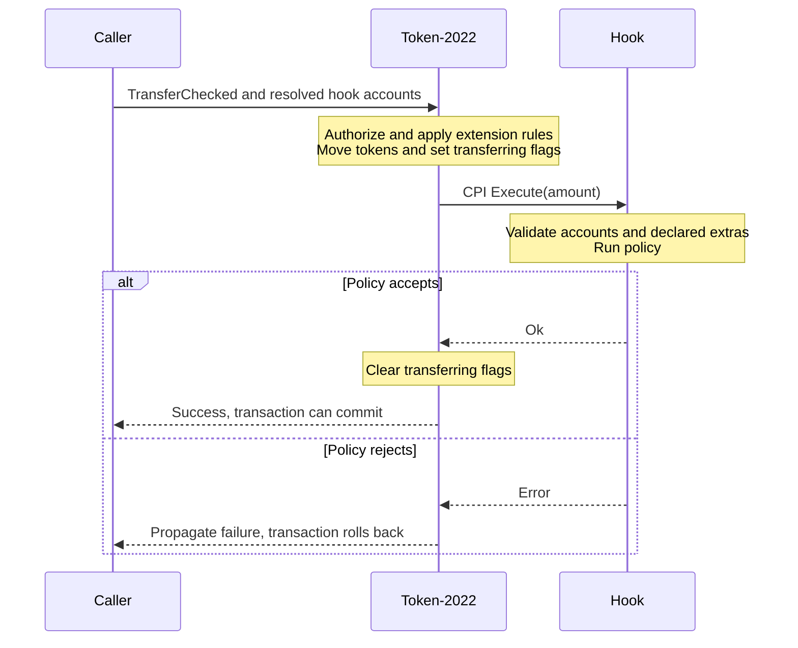
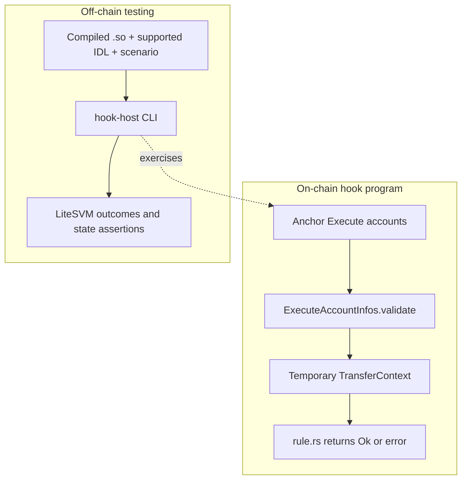

## Transfer hooks in Solana

A Token-2022 mint can select a custom program to run during transfers. Token-2022 still authorizes the transfer and updates balances. Your hook adds a policy, such as recipient eligibility or an amount limit, and can reject the transaction.

This page follows the community kit's real Starter: validate a transfer, apply a 500-unit limit, then test the compiled program. **Follow Starter** from the execution model below, or jump to **[test your own hook](#test-your-own-hook-with-hook-host)** if you already have an implementation. To create a mint and select its hook, use the [official initialization guide](https://solana.com/docs/tokens/extensions/transfer-hook).

Examples were source-reviewed on **30 October 2026** against [`raydium-transfer-hook` at `bc4b4d2`](https://github.com/trilltino/raydium-transfer-hook/tree/bc4b4d2b363de5110c6afc92d0016828c1059519). They target **local LiteSVM**, with no Raydium TypeScript SDK dependency. The kit is private: its source links and clone command require repository access. See [program addresses](/docs/en/reference/program-addresses) for canonical Raydium deployments.

## How a transfer reaches the hook

The [Transfer Hook interface](https://www.solana-program.com/docs/transfer-hook-interface) defines `Execute(amount)`. Token-2022 invokes it through a cross-program invocation, or CPI, using the hook program selected by the mint's TransferHook extension.



The hook sees **post-transfer balances**. Token-2022 sets `transferring` on both token accounts while the hook runs. A propagated hook error rolls back the transaction's state changes, including an earlier successful instruction in that transaction. Transaction fees still apply.

The fixed hook accounts are read-only and unsigned. Token-2022 authorizes the owner or delegate before calling the hook; that authority's signer privilege does not carry into `Execute`. The authority may differ from the source token-account owner, and neither address identifies a person by itself.

Use `TransferChecked` so Token-2022 receives the mint. Mint, burn and authority-change instructions do not invoke a transfer hook. Self-transfers can return without invoking it, so a successful self-transfer does not prove your policy ran. Clients must supply the resolved extra accounts; Token-2022 cannot look them up over RPC.

## Accounts and the metadata list

For hooks using an extra-account metadata list, `Execute` receives four transfer-related accounts, the list, then its declared extras:

| Position | Account | Purpose |
|---|---|---|
| 0 | Source token account | Holds the balance after the debit. |
| 1 | Mint | Identifies the token and selected hook. |
| 2 | Destination token account | Holds the balance after the credit. |
| 3 | Owner or delegate | Authority already checked by Token-2022; unsigned here. |
| 4 | Extra-account metadata-list PDA | Describes the hook's additional accounts. |
| 5+ | Declared extra accounts | Policy configuration, credentials or other dependencies. |

The list's PDA uses `["extra-account-metas", mint]` under the hook program. Its type-length-value (TLV) data describes each extra account's address or derivation and required privileges. Entries can use fixed keys, instruction data, or keys and data from earlier accounts. See the interface's [extra-account configuration](https://www.solana-program.com/docs/transfer-hook-interface/configuring-extra-accounts).

The Starter declares one extra: a read-only, unsigned configuration PDA at position 5, derived from `["hook-config", mint]`. Its [`EXTRA_ACCOUNT_META_LIST`](https://github.com/trilltino/raydium-transfer-hook/blob/bc4b4d2b363de5110c6afc92d0016828c1059519/templates/simple/transfer-hook-starter/src/state/mod.rs) references the mint at index 1. The configuration stores the limit used below.

Your client reads the mint and metadata list, resolves the entries, and includes the hook program, list and extras in the checked transfer. An on-chain caller must forward those accounts into its CPI. Token-2022 cannot fetch missing accounts. Use the [official integration helpers](https://solana.com/docs/tokens/extensions/transfer-hook-integration) and [PDA/CPI fundamentals](/docs/en/solana-fundamentals/pdas-and-cpis) for the caller side.

## From transfer accounts to policy checks

[`hook-kit`](https://github.com/trilltino/raydium-transfer-hook/tree/bc4b4d2b363de5110c6afc92d0016828c1059519/hook-kit) is a Rust library compiled into your hook program. Its validation produces a temporary `TransferContext` for your policy. [`hook-host`](https://github.com/trilltino/raydium-transfer-hook/tree/bc4b4d2b363de5110c6afc92d0016828c1059519/hook-host) runs on your development machine: it builds test transactions, resolves accounts and checks execution outcomes.



The Starter's [`lib.rs`](https://github.com/trilltino/raydium-transfer-hook/blob/bc4b4d2b363de5110c6afc92d0016828c1059519/templates/simple/transfer-hook-starter/src/lib.rs) dispatches the SPL `Execute` discriminator to its handler. Anchor validates the accounts struct first. The handler then calls shared validation before applying the rule. This excerpt is from [`instructions/execute.rs`](https://github.com/trilltino/raydium-transfer-hook/blob/bc4b4d2b363de5110c6afc92d0016828c1059519/templates/simple/transfer-hook-starter/src/instructions/execute.rs); it requires that file's imports, ownership checks, configuration-version check and Anchor account constraints.

```rust execute.rs
let transfer_hook_config = accounts.transfer_hook_config.to_account_info();
let transfer_context = accounts
    .execute_account_infos(accounts.transfer_hook_config.extra_account_meta_list_bump)
    .validate(
        ctx.program_id,
        amount,
        &[&transfer_hook_config],
        ctx.remaining_accounts,
        &EXTRA_ACCOUNT_META_LIST,
    )?;
```

After the version check, the handler passes the validated values to the policy:

```rust execute.rs
rule::enforce_transfer_limit(
    &accounts.transfer_hook_config.rule_params,
    &transfer_context,
)?;
```

[`ExecuteAccountInfos::validate`](https://github.com/trilltino/raydium-transfer-hook/blob/bc4b4d2b363de5110c6afc92d0016828c1059519/hook-kit/src/execute.rs) checks the Token-2022 mint selects this hook, both token accounts belong to that mint, and both `transferring` flags are set. It checks the exact declared account count, rejects unexpected remaining accounts, and enforces read-only/unsigned fixed accounts and declared extra-account privileges. It also verifies the metadata PDA's address, owner and exact canonical bytes.

The mint and token readers enforce Token-2022 ownership. The Starter also checks accepted token-program owners before shared validation. Its Anchor constraints bind the configuration's address, discriminator, owner and mint. Keep those constraints: the shared validator does not replace each template's extra-account bindings or policy-specific checks.

`TransferContext` contains the amount, involved account addresses and post-transfer balances. It is a Rust value for this invocation, not an on-chain state account. Calling `hook-kit` or `rule.rs` is an ordinary Rust call. A CPI happens when your program invokes another on-chain program.

Each template still owns setup authority, issuer permissions, trusted CPI targets, state writes, operational restrictions and error behavior. [`extra_account_metas.rs`](https://github.com/trilltino/raydium-transfer-hook/blob/bc4b4d2b363de5110c6afc92d0016828c1059519/hook-kit/src/extra_account_metas.rs) constructs canonical metadata. [`cpi.rs`](https://github.com/trilltino/raydium-transfer-hook/blob/bc4b4d2b363de5110c6afc92d0016828c1059519/hook-kit/src/cpi.rs) forwards hook extras when another on-chain program transfers hooked tokens; the caller must already supply the needed accounts.

### Worked example with a transfer limit

The Starter's [`rule.rs`](https://github.com/trilltino/raydium-transfer-hook/blob/bc4b4d2b363de5110c6afc92d0016828c1059519/templates/simple/transfer-hook-starter/src/rule.rs) defines `RuleParams { limit: u64 }`. Setup rejects a zero limit. Its complete transfer rule is:

```rust rule.rs
pub fn enforce_transfer_limit(
    rule_params: &RuleParams,
    transfer_context: &TransferContext,
) -> Result<(), TransferHookStarterError> {
    if transfer_context.amount > rule_params.limit {
        return Err(TransferHookStarterError::TransferExceedsLimit);
    }
    Ok(())
}
```

| Raw amount with limit 500 | Expected outcome |
|---|---|
| 499 | Allowed. |
| 500 | Allowed: inclusive boundary. |
| 501 | Rejected with `TransferExceedsLimit`. |

The rule compares validated values. It does not parse accounts, resolve metadata, validate token owners or record a transfer. On a mint with six decimals, 500 raw units are 0.0005 tokens. A per-transfer cap does not prevent splitting a larger transfer into smaller transfers or using multiple wallets.

The Starter's [`initialize.rs`](https://github.com/trilltino/raydium-transfer-hook/blob/bc4b4d2b363de5110c6afc92d0016828c1059519/templates/simple/transfer-hook-starter/src/instructions/initialize.rs) verifies the mint's hook authority and rejects confidential-transfer mint extensions because this policy needs a visible amount. Review a template's setup checks before choosing other extensions.

## Build, test and adapt the Starter

You need access to the kit and its [build toolchain](https://github.com/trilltino/raydium-transfer-hook/blob/bc4b4d2b363de5110c6afc92d0016828c1059519/CONTRIBUTING.md#tests): Rust 1.99.1, Anchor 1.2.1, Agave 4.3.2, `cargo-build-sbf` 4.4.0 and platform-tools v1.58 at the reviewed revision. Install those prerequisites separately. The CLI does not install them for you.

Run this sequence from the directory where you want the checkout. After `cd`, commands run from the kit root. Checking out the reviewed commit keeps source, IDLs and examples aligned. Installation and builds can download dependencies; LiteSVM execution needs no funded wallet, SOL or validator.

```bash
git clone https://github.com/trilltino/raydium-transfer-hook.git
cd raydium-transfer-hook
git checkout bc4b4d2b363de5110c6afc92d0016828c1059519
cargo test --locked -p transfer-hook-starter --lib
cargo install --path hook-host --features templates --bin test-templates --locked
test-templates build --template starter
test-templates local --template starter --report starter-local.json
```

The native tests check policy boundaries and pure Rust behavior. `build` produces the SBF `.so` program. `local` executes compiled instructions through Token-2022 under LiteSVM. Inspect the exact error, accepted amounts, final balances and state checks. Use a fresh report filename for each run: existing files are not replaced.

The typed [`starter.rs`](https://github.com/trilltino/raydium-transfer-hook/blob/bc4b4d2b363de5110c6afc92d0016828c1059519/hook-host/litesvm-examples/starter.rs) fixture starts with 5,000 source units, zero destination units and limit 500. Its transfer helper requires hook invocation in the execution logs and checks both balances. An accepted 500 leaves 4,500 and 500; zero still invokes the hook; rejected 501 leaves those balances unchanged.

The full typed example also checks direct-call rejection, malformed accounts, relay-state rollback and an accepted first instruction followed by a rejected second instruction. These are separate cases from the CLI's built-in workflow. Use the [Rust testing instructions](https://github.com/trilltino/raydium-transfer-hook/blob/bc4b4d2b363de5110c6afc92d0016828c1059519/CONTRIBUTING.md#tests) to build its relay dependency, then run `cargo run --locked -p hook-host --features litesvm --example starter`. The Cargo example target remains `starter` despite its move to `litesvm-examples/`.

Rollback assertions compare writable transaction accounts and explicitly monitored state; add other policy accounts to `monitored_accounts`. The fee payer is excluded from unchanged-account comparisons. Require hook invocation as well as success, and verify promised state changes explicitly. An unasserted account is not evidence of your intended behavior.

### Make the policy your own

1. Define one passing transfer and one refusal. Start by editing `templates/simple/transfer-hook-starter/src/rule.rs` and its `RuleParams`.
2. Update the native tests beside the rule, including zero, the inclusive boundary, one over and arithmetic extremes.
3. Update the host expectations in the typed example, template workflow or JSON scenario you use. Keep account constraints, canonical metadata and authority checks intact.
4. Rebuild the `.so`. Regenerate the IDL if instructions, accounts or state layouts changed, then rerun compiled cases with matching artifacts.
5. For an independent program, follow the [registration checklist](https://github.com/trilltino/raydium-transfer-hook/blob/bc4b4d2b363de5110c6afc92d0016828c1059519/AGENTS.md#registering-a-new-program) and use an ID you control before cluster deployment.

## Test your own hook with `hook-host`

You can test your own program without adopting a template client crate. The handoff is **compiled `.so` + supported IDL + scenario setup and assertions**. The host runs that program and checks the expectations you supply.

Build with the program ID recorded in the matching IDL. With `test-templates` installed, run these commands from your hook project root, editing the generated file between commands:

```bash
test-templates init-scenario --idl target/idl/my_hook.json --out tests/my-cases.json
```

Configure valid setup arguments, authorities, signers, wallet/token accounts, PDA references and any CPI dependencies. Replace unresolved accounts and neutral defaults. Specify a passing transfer, a refusal with the exact expected error, and balance or decoded-state assertions. Then pass the actual binary:

```bash
test-templates local --scenario tests/my-cases.json --program target/deploy/my_hook.so --report my-hook-local.json
```

Paths inside JSON are relative to the scenario file; CLI paths are relative to your working directory. Write raw token amounts and 64-bit integers as decimal strings. Explicitly declare writable policy extras in a transfer's `writable` field. If you only need custom scenarios, install with `--features cluster`; `templates` includes that feature and adds built-in template clients.

The [Starter scenario](https://github.com/trilltino/raydium-transfer-hook/blob/bc4b4d2b363de5110c6afc92d0016828c1059519/hook-host/scenario-definitions/starter.json) initializes limit 500 and asserts the stored value. These consecutive entries are an exact excerpt from its `steps` array, not a standalone scenario:

```json starter.json
    {
      "name": "500 is accepted",
      "transfer": {
        "from": "a",
        "to": "b",
        "amount": "500"
      },
      "expect": "success"
    },
    {
      "name": "501 is refused",
      "transfer": {
        "from": "a",
        "to": "b",
        "amount": "501"
      },
      "expect": {
        "error": "TransferExceedsLimit"
      }
    },
    {
      "name": "bob holds 500",
      "assert": {
        "balance": {
          "account": "b",
          "equals": "500"
        }
      }
    }
```

The IDL describes structure; it cannot infer your issuer, authorization model, intended refusal or expected balances. The current [IDL reader](https://github.com/trilltino/raydium-transfer-hook/blob/bc4b4d2b363de5110c6afc92d0016828c1059519/hook-host/src/tooling/custom/idl.rs) rejects composite account groups: flatten the account list. Native Rust or Pinocchio programs can supply a compatible minimal IDL, but the runner supports a defined type/seed vocabulary. Use typed Rust cases when your setup or assertions exceed it. Consult the [schema and resolver](https://github.com/trilltino/raydium-transfer-hook/tree/bc4b4d2b363de5110c6afc92d0016828c1059519/hook-host/src/tooling/custom) and [scenario collection](https://github.com/trilltino/raydium-transfer-hook/tree/bc4b4d2b363de5110c6afc92d0016828c1059519/hook-host/scenario-definitions).

Inspect the report and observed state. The host checks configured expectations; it cannot choose your policy, supply missing signer authority, audit your hook or add account forwarding to your production client.

<span id="advanced-workflows" />

### Other execution environments

The [host guide](https://github.com/trilltino/raydium-transfer-hook/blob/bc4b4d2b363de5110c6afc92d0016828c1059519/hook-host/GUIDE.md) covers these separate paths:

- **Existing mint:** `test-hook generate` and `test-hook run` resolve the configured hook's accounts and use supplied owner/delegate signers. They do not deploy a program.
- **Authorized cluster:** `test-templates run --scenario` deploys and executes on Devnet or a local validator. It requires matching keypairs, funding and confirmed transaction checks. Review its deployment and cleanup behavior before use.
- **Pool integration fork:** `test-templates amm --scenario` requires the separate CPMM/CLMM integration workspace, deployment manifest and matching builders. The [Starter pool scenario](https://github.com/trilltino/raydium-transfer-hook/blob/bc4b4d2b363de5110c6afc92d0016828c1059519/hook-host/scenario-definitions/amm-starter.json) includes pool setup, swaps and liquidity cases. It cannot run as a local direct-transfer scenario.

## Raydium integration context

A hook belongs to a mint. Mint admission and forwarding hook extras are separate integration requirements. Check the canonical [Token-2022 support matrix](/docs/en/reference/token-2022-support) for product status. The kit's pool tests exercise community integration forks, which are separate from official Raydium deployments.

For every operation, resolve extras using the actual mint, authority and amount on each transfer leg. Test swaps, liquidity deposits and withdrawals, and applicable fee/reward transfers. LaunchLab setup and graduation need their own integration tests. A passing direct transfer does not establish any of those paths.

For a concrete policy, Trader Eligibility's [`classify()` and `required()`](https://github.com/trilltino/raydium-transfer-hook/blob/bc4b4d2b363de5110c6afc92d0016828c1059519/templates/launch-and-trading/trader-eligibility/src/rule.rs) use registered token-account addresses:

| Transfer direction | Classification | Required credentials |
|---|---|---|
| Registered vault to user token account | `Buy` | Destination token-account owner. |
| User token account to vault, `OpenExit` | `Sell` | No sell-side credentials; local transfer cap still applies. |
| User token account to vault, `RequireCredential` | `Sell` | Source token-account owner. |
| Ordinary token account to another ordinary account | `Transfer` | Both token-account owners. |

`Buy` and `Sell` describe token flow, not proof of a swap. A liquidity withdrawal can look like a buy; a direct deposit can look like a sell. `OpenExit` therefore does not guarantee all LP withdrawals remain possible. A cap or revoked recipient credential can still block an outgoing vault transfer.

The [`Execute` handler](https://github.com/trilltino/raydium-transfer-hook/blob/bc4b4d2b363de5110c6afc92d0016828c1059519/templates/launch-and-trading/trader-eligibility/src/instructions/execute.rs) binds a recognized vault to its registered authority and checks `ImmutableOwner`. It also requires immutable destination ownership when checking that owner's credential. The credential subject is the token-account owner, not necessarily the transfer authority. Issuers perform identity checks outside the hook; a wallet credential alone does not prove a unique person.

Choose an extension point after defining the policy and exits:

- **Compose rules:** [Multi-Policy](https://github.com/trilltino/raydium-transfer-hook/tree/bc4b4d2b363de5110c6afc92d0016828c1059519/templates/intermediate/multi-policy) combines local limits with an external allowlist CPI. Pin the callee and declare its accounts.
- **Gate recipients or trading:** [Credential Gate](https://github.com/trilltino/raydium-transfer-hook/tree/bc4b4d2b363de5110c6afc92d0016828c1059519/templates/launch-and-trading/credential-gate) offers one registered vault; Trader Eligibility adds venue and sell-policy choices.
- **Limit a launch window:** [Fair Launch](https://github.com/trilltino/raydium-transfer-hook/blob/bc4b4d2b363de5110c6afc92d0016828c1059519/templates/intermediate/fair-launch/src/rule.rs) uses time, slot, amount, account-balance and wallet-purchase inputs. State which transfers count and test wallet splitting and paths outside the window.
- **Distribute funding:** [Fee Split Rewards](https://github.com/trilltino/raydium-transfer-hook/blob/bc4b4d2b363de5110c6afc92d0016828c1059519/templates/launch-and-trading/fee-split-rewards/src/instructions/fund_split.rs) allocates supplied funds to creator, platform and holders. Your integration must collect and supply them. It does not extract CPMM fees, change pool fee configuration, migrate or lock LP, compound liquidity, or implement LaunchLab graduation.

## Design and contribution checklist

- Define the policy, controller, issuer and upgrade authority. Include a passing and refusing case.
- Verify hook selection, Token-2022 ownership, mint bindings, genuine `Execute` dispatch and both transfer-in-progress flags.
- Preserve canonical metadata, account order/count, signer/writable privileges and extra-account bindings. Forward extras on every real CPI transfer leg.
- Distinguish transfer authority from token-account owner. Consider mint/burn and authority changes separately; use `ImmutableOwner` where an owner-based policy needs it.
- Test zero, limits, arithmetic extremes, self-transfer, entry, exit and relevant extension combinations. Check exact errors and rollback, including earlier instructions in the same rejected transaction.
- Separate native policy tests, compiled LiteSVM execution, confirmed cluster transactions and pool-fork integration results. Assert promised state changes and monitor state that must remain unchanged.

## Scope and change disclaimer

This community example implies no security audit. Behavior depends on the exact deployment, cluster, mint extensions and caller. Recheck each affected Raydium operation when those inputs change. The kit's [scope disclaimer](https://github.com/trilltino/raydium-transfer-hook/blob/bc4b4d2b363de5110c6afc92d0016828c1059519/DISCLAIMER.md) and [contribution guide](https://github.com/trilltino/raydium-transfer-hook/blob/bc4b4d2b363de5110c6afc92d0016828c1059519/CONTRIBUTING.md) describe review and testing responsibilities. Public access to the kit requires a separate maintainer visibility decision.

## Further reading

- [Token-2022 overview](https://www.solana-program.com/docs/token-2022)
- [Transfer Hook interface](https://www.solana-program.com/docs/transfer-hook-interface)
- [SPL Token and Token-2022](/docs/en/solana-fundamentals/spl-token-and-token-2022)
- [Kit README](https://github.com/trilltino/raydium-transfer-hook/blob/bc4b4d2b363de5110c6afc92d0016828c1059519/README.md)
